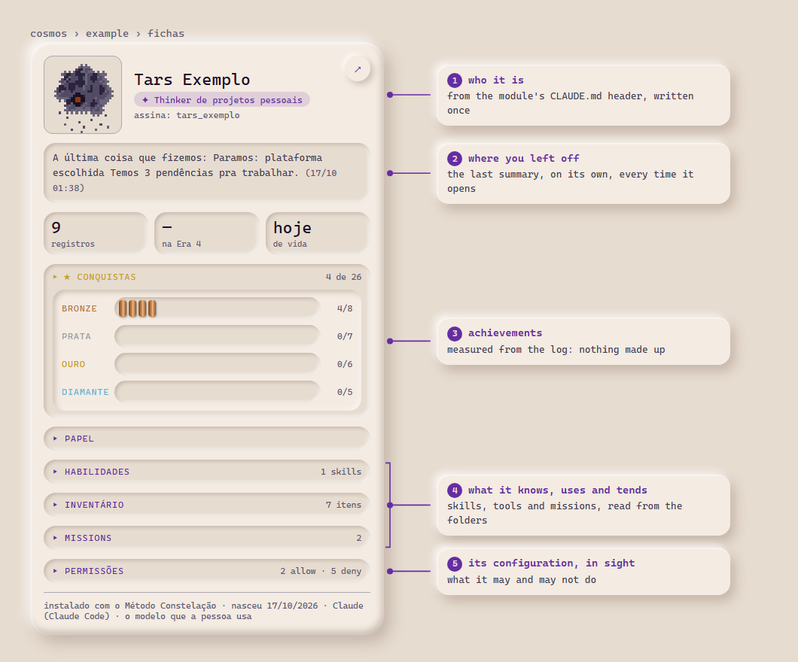
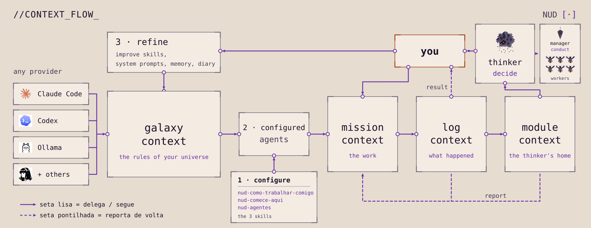

<a href="README.pt-BR.md">🇧🇷 Português</a>

<picture>
  <source media="(prefers-color-scheme: dark)" srcset="assets/banner-night.svg">
  
</picture>

# Constellation Method

Method for managing several areas and projects from a minimum context that steers everything, with agents in three angles of function.

---

## Install

Install the **`nud-install-constellation-method`** skill on your agent and ask: *"install the Constellation Method for me"*. It talks with you, explains what the method asks of you and installs the current version on your computer.

- **Download:** [`nud-install-constellation-method.zip`](nud-install-constellation-method.zip), to upload to your app, or the [open folder](nud-install-constellation-method/), to copy into your skills directory (e.g. `.claude/skills/` in Claude Code).
- **Where it runs:** tested on Claude Code, with Python 3.10 or newer.
- **Rather do it by hand?** The whole step by step is in [`INSTALL.md`](era-4-scripts-and-interface/INSTALL.md).

*The skills and templates are written in Brazilian Portuguese; the agent installing them can talk with you in your language.*

A thinker's profile card in the dashboard that comes with it, with the example data ([the other views](era-4-scripts-and-interface/)):

> 🚧 **Work in progress:** the dashboard is being built in public and changes often, so what you see here may differ from the latest version.

<picture>
  <source media="(prefers-color-scheme: dark)" srcset="assets/ficha_anotada_en_noite.png">
  
</picture>

## What it is

It is a way to organize context so AI can help me manage my life. I started simple: markdown files inside projects in the provider's interface, which the instance read at the start of each job. I documented it here as it scaled. Today I have a system I designed to be model-agnostic, I've run it on the platforms I've tested (Claude Code, Hermes, Codex), and I manage my whole life from three agent functions: thinker, manager and worker. This is how I use it and it works for me; if you try it somewhere else, I'd genuinely like to hear how it went. It's transforming my life. It gives me more autonomy and capacity to create, and it made me a healthier person.

I still have a lot to improve and learn, so improvements will always arrive in this repository. Here I explain how to install and start using my agents and my method of context flow for whatever you want: managing a life, a project, or an annoying task from your job.

The hypothesis behind it: the structure around the model (the context it receives and the checking that stays outside it) changes its behavior in two ways: it builds common ground between the person and the agent, which lowers communication friction (fewer misunderstandings, less explaining everything again), and it lowers error and the agreement that only pleases. I treat it as a hypothesis, in daily use, not as a proven fact. Where it came from is in the [`MANIFESTO`](MANIFESTO.md); what it leans on and what rung it is on, in [`FOUNDATIONS`](history/FOUNDATIONS.md) (in Portuguese).

<picture>
  <source media="(prefers-color-scheme: dark)" srcset="assets/context-flow-night.svg">
  
</picture>

## The eras

The method grew in eras. Each era goes up to the point where the way of working stopped coping and asked for another scale, and each one uses the ones before it:

| Era | What it improved |
|---|---|
| [**1. The Triad**](era-1-triad/) | The minimum context in three documents (the door, the manual and the function) and three agent roles. |
| [**2. States and diaries**](era-2-states-and-diaries/) | The structure leaves the app's project and moves to folders on the computer, and memory between conversations comes in, kept by hand. |
| [**3. Configs and hooks**](era-3-configs-and-hooks/) | The minimum context becomes agent configuration, and hooks make sure the context arrives, without depending on anyone remembering. |
| [**4. Scripts and interface**](era-4-scripts-and-interface/) | The context flow is standardized and automated, the past becomes searchable reference context, and a dashboard shows missions, pending tasks and profile cards. This is the version the skill installs. |

## What's here

- [`nud-install-constellation-method/`](nud-install-constellation-method/): the skill that installs the method.
- `era-1-triad/` to `era-4-scripts-and-interface/`: one folder per era, each with only what it adds.
- [`history/`](history/): the [chronology](history/cronologia/), [`FOUNDATIONS`](history/FOUNDATIONS.md) and the [`DEVLOG`](history/DEVLOG.md) (what changed, when, and what the check knocked down).
- [`MANIFESTO`](MANIFESTO.md): where this came from.

## License

- **Method, templates and texts:** [CC BY 4.0](https://creativecommons.org/licenses/by/4.0/)
- **Any code or script:** MIT.
