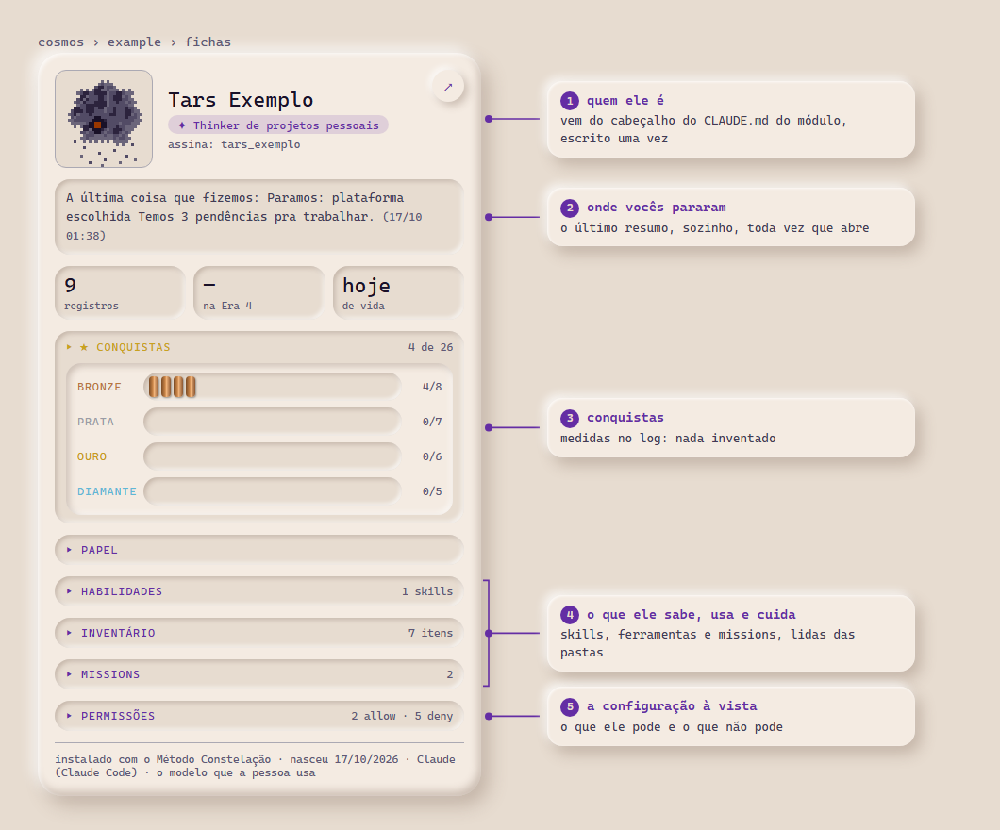

<a href="README.md">🇺🇸 English</a>

<picture>
  <source media="(prefers-color-scheme: dark)" srcset="assets/banner-night.svg">
  
</picture>

# Método Constelação

Método de gerenciar várias áreas e projetos a partir de um contexto mínimo que direciona tudo, com agentes em três ângulos de função.

---

## Instalar

Instale a skill **`nud-install-constellation-method`** no seu agente e peça: *"instala o Método Constelação pra mim"*. Ele conversa com você, explica o que o método pede e instala a versão atual no seu computador.

- **Baixar:** [`nud-install-constellation-method.zip`](nud-install-constellation-method.zip), pra subir no app, ou a [pasta aberta](nud-install-constellation-method/), pra copiar pro diretório de skills (ex.: `.claude/skills/` no Claude Code).
- **Onde roda:** testado no Claude Code, com Python 3.10 ou mais novo.
- **Prefere fazer à mão?** O passo a passo inteiro está no [`INSTALAR.md`](era-4-scripts-and-interface/INSTALAR.md).

A ficha de um thinker no painel que vem junto, com os dados de exemplo ([as outras vistas](era-4-scripts-and-interface/)):

<picture>
  <source media="(prefers-color-scheme: dark)" srcset="assets/ficha_anotada_pt_noite.png">
  
</picture>

## O que é

É um jeito de organizar contexto para que a IA consiga me ajudar a gerenciar a minha vida. Comecei simples: arquivos markdown dentro de projetos na interface do provedor, que a instância lia no início de cada trabalho. Fui documentando aqui conforme escalava. Hoje tenho um sistema que projetei para ser agnóstico de modelo, já rodei nas plataformas que testei (Claude Code, Hermes, Codex), e gerencio toda a minha vida a partir de três funções de agente: thinker, manager e worker. É assim que eu uso e funciona pra mim; se você testar em outro lugar, eu ia adorar saber como foi. Isso está transformando a minha vida. Me dá mais autonomia e capacidade de criação, e me deixou uma pessoa mais saudável.

Ainda tenho muito pra melhorar e aprender, por isso as melhorias vão sempre chegar a este repositório. Aqui explico como instalar e começar a usar os meus agentes e o meu método de fluxo de contexto para o que você quiser: gerenciar uma vida, um projeto, ou uma demanda chata do seu trabalho.

A hipótese por trás: a estrutura em volta do modelo (o contexto que ele recebe e a conferência que fica fora dele) muda o comportamento dele de duas formas: cria um chão comum entre a pessoa e o agente, o que diminui o atrito de comunicação (menos mal-entendido, menos explicar tudo de novo), e diminui o erro e a concordância que só agrada. Trato como hipótese, em uso diário, não como fato provado. De onde isso veio está no [`MANIFESTO`](MANIFESTO.pt-BR.md); em que se apoia e em que degrau está, no [`FOUNDATIONS`](history/FOUNDATIONS.md).

<picture>
  <source media="(prefers-color-scheme: dark)" srcset="assets/context-flow-night.svg">
  
</picture>

## As eras

O método cresceu em eras. Cada era vai até o ponto em que a forma de trabalhar deixou de dar conta e pediu outra escala, e cada uma usa as anteriores:

| Era | O que melhorou |
|---|---|
| [**1. A Tríade**](era-1-triad/) | O contexto mínimo em três documentos (a porta, o manual e a função) e três papéis de agente. |
| [**2. Estados e diários**](era-2-states-and-diaries/) | A estrutura sai do projeto do app e vai pras pastas do computador, e entra a memória entre conversas, mantida à mão. |
| [**3. Configs e hooks**](era-3-configs-and-hooks/) | O contexto mínimo vira configuração de agente, e os hooks garantem que o contexto chegue, sem depender de alguém lembrar. |
| [**4. Scripts e interface**](era-4-scripts-and-interface/) | O fluxo de contexto é padronizado e automatizado, o passado vira contexto de consulta, buscável, e um painel mostra as missions, as pendências e as fichas. É a versão que a skill instala. |

## O que tem aqui

- [`nud-install-constellation-method/`](nud-install-constellation-method/): a skill que instala o método.
- `era-1-triad/` a `era-4-scripts-and-interface/`: uma pasta por era, cada uma só com o que ela acrescenta.
- [`history/`](history/): a [cronologia](history/cronologia/), o [`FOUNDATIONS`](history/FOUNDATIONS.md) e o [`DEVLOG`](history/DEVLOG.md) (o que mudou, quando, e o que a conferência derrubou).
- [`MANIFESTO`](MANIFESTO.pt-BR.md): de onde isso veio.

## Licença

- **Método, templates e textos:** [CC BY 4.0](https://creativecommons.org/licenses/by/4.0/)
- **Qualquer código ou script:** MIT.
