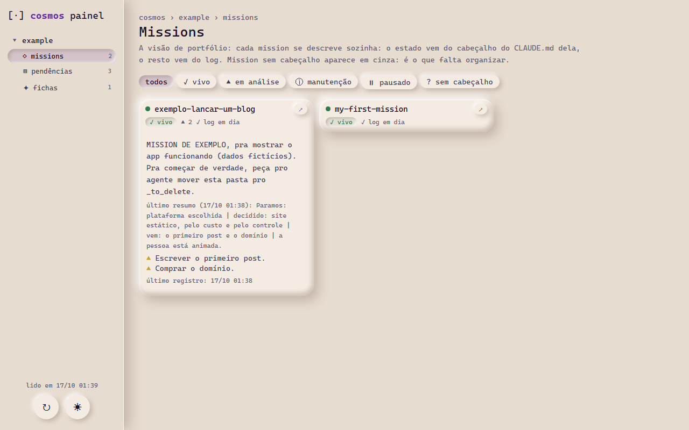
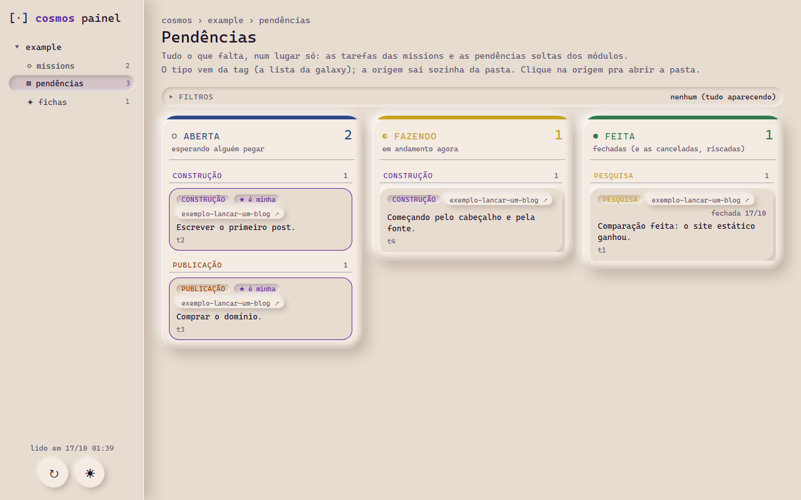
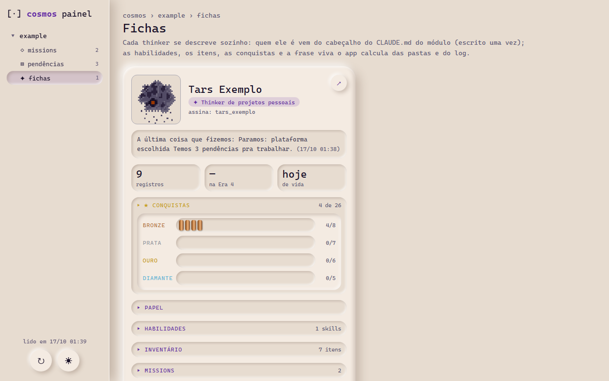

# Era 4: scripts e interface
*Usa as Eras 1, 2 e 3 e acrescenta a automação do fluxo de contexto e o painel. É a versão que a skill [`nud-install-constellation-method`](../nud-install-constellation-method/) instala.*

**O que melhorou em relação à Era 3:** na Era 3, o contexto chegava pela configuração, mas o registro do que aconteceu ainda dependia da instância lembrar de escrever, e do jeito certo; e o passado ficava espalhado em arquivos soltos. Na Era 4:
- **um registrador único** escreve o log de cada casa e de cada mission, e recusa a linha que vem errada;
- **os hooks entregam sozinhos:** ao abrir uma conversa, o último resumo, as tarefas e o último diário; ao tocar numa mission, o resumo dela;
- **o passado vira contexto de consulta:** o galley busca nos registros antigos por sentido e por palavra;
- **o painel** mostra as missions, as pendências e a ficha de cada thinker, lidos dos logs. Ele só lê.

## O painel

> 🚧 **Em andamento** (*work in progress*): o painel está sendo construído em público e muda com frequência. O que aparece aqui pode estar diferente da versão mais nova.

As imagens abaixo são do modelo, com os dados de exemplo que vêm com ele.

**Missions:** cada mission se descreve sozinha; o estado vem do cabeçalho do `CLAUDE.md` dela, o resto vem do log.

<picture>
  <source media="(prefers-color-scheme: dark)" srcset="assets/app_missions_noite.png">
  
</picture>

**Pendências:** tudo o que falta, num lugar só, por estado; o "★ é minha" marca o que só depende da pessoa.

<picture>
  <source media="(prefers-color-scheme: dark)" srcset="assets/app_pendencias_noite.png">
  
</picture>

**Fichas:** quem é cada thinker, onde vocês pararam, as conquistas, o que ele sabe e usa, e a configuração à vista.

<picture>
  <source media="(prefers-color-scheme: dark)" srcset="assets/app_fichas_noite.png">
  
</picture>

## O que tem aqui

- [`model/cosmos/`](model/cosmos/): o modelo de pastas, com o painel (`app/`), uma galaxy de exemplo, as ferramentas e os hooks.
- [`INSTALAR.md`](INSTALAR.md) / [`INSTALL.md`](INSTALL.md): o passo a passo inteiro, pra quem quer fazer à mão.
- [`OTHER_HARNESSES.md`](OTHER_HARNESSES.md): o que cada peça faz, pra levar a Era 4 pro Codex, o Hermes ou o OpenCode.
