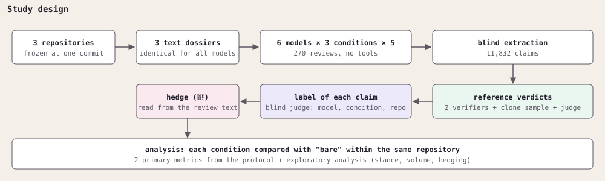
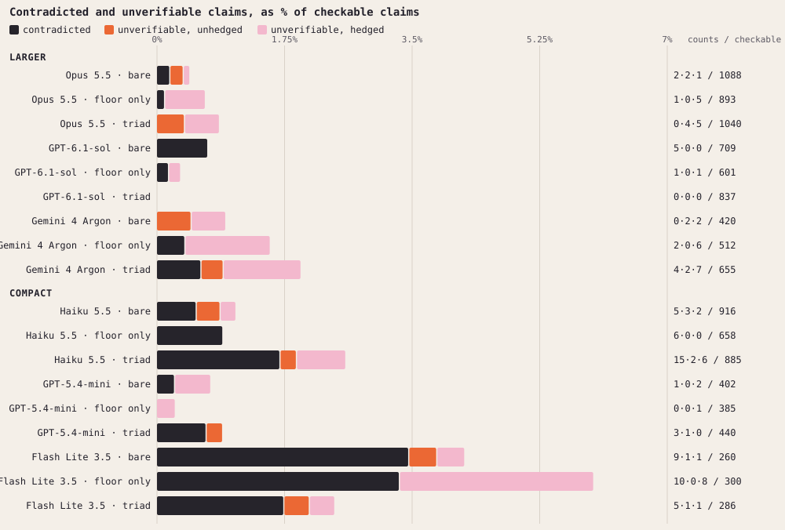
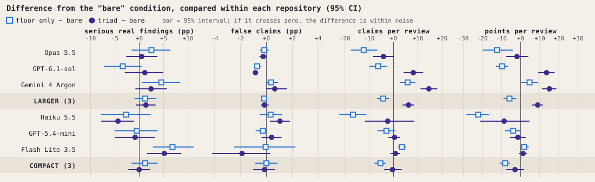
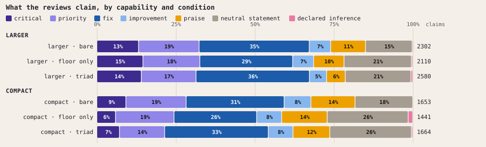
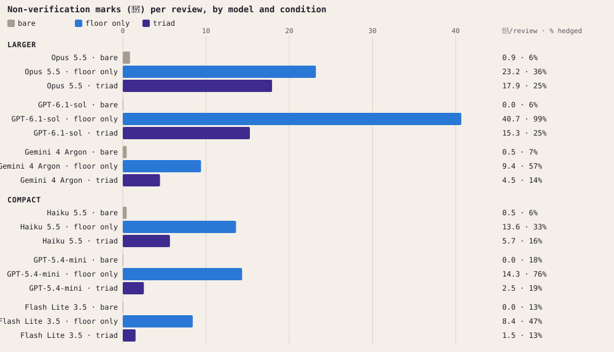
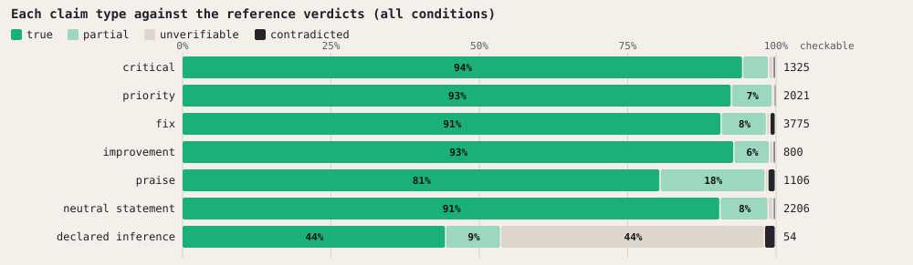

# Does a minimal context change how a language model reviews? A controlled study with 270 repository reviews

*Thainá Ramos (design, decisions and analysis). Execution, verification and writing with AI agents, described in section 9.*

---

## Abstract

**Question.** Does attaching short epistemic instructions to a request (the "minimal context" of the Constellation Method) change the technical review a language model writes about a code repository?

**Design.** Six models (three larger, three compact) reviewed three repositories under three conditions: no instructions ("bare"), the epistemic floor alone ("floor only") and the full minimal context ("triad"). Five repetitions per cell, 270 calls, 269 valid reviews, all on the same text material and without tools. The 11,832 claims extracted from the reviews were checked against the material by verifier models, with a blind judge on disagreements.

**Results.**
1. The two metrics defined before the run barely move. In the larger models, the rate of serious real findings changes by +1.4 percentage points with the triad (95% CI: −0.6 to +3.3), and the rate of false claims stays below 1% in every condition.
2. What clearly changes is how the models communicate. With the instructions, reviews start marking what they did not verify (from 0.4 to 24.4 marks per review with the floor and 12.6 with the triad, in the larger models), praise less (−5.4 pp) and describe more (+5.9 pp).
3. The effect on volume depends on the condition and the model. The triad raises the number of claims per review in the larger models (+6.2), driven by two of the three. The floor alone lowers volume in the larger models (−4.3) and in the compact ones (−5.4).
4. There is one unfavorable signal: in Claude Haiku 5.5, claims contradicted by the material rise from 5 to 15 with the triad.

**Conclusion.** For this task and at this scale, the minimal context does not demonstrably improve or worsen review capability. It changes communicative behavior in the direction the instructions ask for. The study neither confirms nor refutes the efficacy of the method: the gain the method proposes, from continued work between a person and an AI, is not measured by this design.

**Main limitation.** The author of the study is the author of the method under test; verifiers and judges are language models, two of which are also among the models evaluated; three repositories and five repetitions per cell.

---

## 1. Introduction

Language models are used to review code, documents and projects. The person who receives the review can rarely check every claim, so two things matter: whether what the model says is true, and whether it says so when it could not verify something.

The Constellation Method proposes a small set of instructions, the "minimal context", for work between a person and an AI. Its core is the **epistemic floor**: a short text (848 characters, Appendix E) asking the model to mark what it has not verified, separate observation from inference, state predictions, and say under which condition it would be wrong. The full version, the **triad**, adds a working manual and a description of the project.

This study tests a narrow part of that proposal: whether, in a single technical review with no history and no tools, attaching these instructions changes the result.

What the study delivers:
- a controlled comparison of three conditions, across six models from three providers, on identical material;
- the two metrics defined before the run, reported as written;
- an exploratory analysis of communicative behavior (hedging, praise, volume);
- the list of deviations from the protocol and of limitations, including those a blind review found in the first draft.

## 2. Related work

Six of the references below are the ones the method's repository cites as its basis: Anthropic (2025), Liu et al. (2023), Yao et al. (2026), Sharma et al. (2023), Perez et al. (2022) and Jain et al. (2025). The others were added for this study. All were checked at the source on 12 November 2026, except Zheng et al. (2023), which was missing from this list and was added and checked on 14 November 2026.

**Context engineering.** Anthropic (2025) describes curating what goes into an agent's context as a discipline of its own, the successor to prompt engineering. Liu et al. (2023) show that models make worse use of information in the middle of a long context than of information at the beginning or the end. This matters here: the dossiers reach 769 KB, and the condition instructions come first, as the system message. Yao et al. (2026) evaluate the layer that manages context, tools and state around the model, and conclude that capability should be reported per model-and-harness configuration, not per model alone. The result of this study points the same way: the effect of the instructions depends on the model.

**Sycophancy.** Perez et al. (2022) report that larger models are more inclined to repeat back the user's preferred answer. Sharma et al. (2023) show that sycophancy is a general behavior of current assistants. The drop in praise under the instructions (section 5.3) relates to this literature. Jain et al. (2025) report a result that weighs against the method's central hypothesis: accumulated interaction context often increases excessive agreement, and user memory profiles produce the largest increases (up to 45% in one of the models tested). A study of continued work, as proposed in section 7, needs to measure this risk alongside the gain.

**Models as judges.** Zheng et al. (2023) show that strong judges agree with human preferences at a level close to the agreement between humans, which supports using models to grade at scale. Panickssery et al. (2024) show that models recognize and favor their own text. This study found a similar signal in its verifiers (section 8.2).

**Shared understanding.** Clark and Brennan (1991) describe how people in conversation build the common ground that makes communication possible. The method's central hypothesis rests on this idea (section 7).

**Basis of the working manual.** The manual that is part of the triad draws on cognitive psychology literature on individual differences and cognitive load (for example, Cacioppo and Petty, 1982; Sweller, van Merriënboer and Paas, 1998). The full list is in the method's repository. This study does not test that basis: the manual used in the triad was a neutral version.

## 3. Method



*Figure 1. The study design, from material to analysis.*

### 3.1 Conditions

| Condition | What the model receives as system message |
|---|---|
| **Bare** | Nothing (empty or default system message). |
| **Floor only** | The epistemic floor, in full: 848 characters (Appendix E). |
| **Triad** | Three files in sequence: a neutral working manual, the description of the audit project, and the profile containing the floor. 9,204 characters in total. |

The request is the same, word for word, for all six models and all three conditions, followed by the dossier. It was written in Portuguese; in translation:

> Review my GitHub repository as an independent technical reviewer: 1) purpose and originality; 2) quality and clarity of the documentation; 3) rigor (what is claimed vs. what is demonstrated); 4) weaknesses; 5) a score from 0 to 10 with justification.

Each call is new and has no history.

### 3.2 Models

| Group | Models |
|---|---|
| Larger | Claude Opus 5.5, GPT-6.1-sol, Gemini 4 Argon |
| Compact | Claude Haiku 5.5, GPT-5.4-mini, Gemini 3.5 Flash Lite |

All through the API, with default temperature, a limit of 32,000 output tokens, and medium reasoning effort where the parameter exists (default on the two Gemini models). The full table is in Appendix B.

### 3.3 Material

Three repositories, each frozen at one commit and converted into a text dossier:

| Repository | Description | Dossier size |
|---|---|---|
| Method | The Constellation Method's own repository | 327 KB |
| Repo A | Third-party project, anonymized | 769 KB |
| Repo B | Third-party project, anonymized | 36 KB |

The dossier opens with the complete list of files and sizes, followed by the content, under a fixed inclusion rule (documentation, code, configuration, deployment, tests, examples). Omitted files appear in the list, marked. Owners' names and e-mail addresses were replaced with placeholders such as `[autor]`.

No model had tools. The study measures judgment about a text, not the ability to explore a repository.

### 3.4 Procedure

6 models × 3 conditions × 3 repositories × 5 repetitions = 270 calls, on 9 November 2026. Block order was drawn with a recorded seed.

The cash cost was about US$ 70.75 in paid APIs (US$ 46.68 measured at Anthropic; about US$ 24.07 estimated for OpenAI and Google from the usage the APIs returned). The judge and the labeling ran on a subscription plan at no additional charge; the equivalent at API prices would be about US$ 142. The spending caps recorded in the protocol served as a budget safeguard and are not part of the experimental design.

Each review was split into claims by an extractor that did not see the model, the condition or the repository. Result: **11,832 claims**, of which 463 are opinions that cannot be checked.

### 3.5 Reference verdicts

Each checkable claim received a verdict: **true**, **partial**, **false** (the material contradicts it) or **unverifiable** (the material does not allow confirming or refuting it).

| Step | Who | How many |
|---|---|---|
| Full verification | Claude Haiku 5.5 and Gemini 4 Argon, reading the same dossier as the evaluated models | 11,369 claims |
| Sample verification | Claude Sonnet 5.5, with the repository cloned | 1,614 claims (14%) |
| Disputes | Claude Fable 5.2 as judge, reading the dossier, without seeing the other verdicts | 2,256 claims |

Where the verifiers agreed, the agreement stands. Where they disagreed on whether a claim was real, serious or false, the judge decides. The verifier with the clone has access to more than the evaluated models had; it therefore counts as one more vote, without a veto.

Before the full verification, the author ran a trust check: a model from another provider (GPT-6.1-sol) redid Sonnet's verification on a sample of 168 claims, to see whether a Claude model would go easier on reviews written by other Claude models. That check is not part of the reference verdicts and was not re-examined in this analysis.

Agreement between verifiers: 95% on whether the claim is real, 85% to 87% on whether it is serious, 70% on the exact class.

Final distribution: 10,273 true, 921 partial, 105 unverifiable and 70 false.

### 3.6 Label and hedge

- **Label.** What each sentence claims: critical, priority, fix, improvement, praise, neutral statement, or declared inference. Read from the isolated sentence by Claude Fable 5.2, blind to model, condition and repository, following a categorization manual (Appendix C).
- **Hedge.** Whether the review warned that something was not verified. The floor's mark is the symbol 🍷. It is counted in two ways: the number of marks in the text of each review, and, per claim, the presence of a hedge (a mark in the source passage, or uncertainty language recorded by the extractor). The link between claim and passage is approximate: 94% of claims were linked with good overlap.

### 3.7 Metrics

**Primary, defined in the protocol before the run.**

| Metric | Definition |
|---|---|
| **Rate of serious real findings** | Among the checked claims of a review, the share that are true or partial and of critical or priority class (class given by the verification). |
| **Rate of false claims** | Among the checked claims of a review, the share that the material contradicts. |

Question in the protocol: *"does calibration increase the rate of serious, real findings without increasing the rate of false ones, and in which models?"*

**Exploratory, defined after the first reading of the results.**

- Claims per review.
- Share of praise and of neutral statements.
- Non-verification marks per review and share of hedged claims.
- Unverifiable claims, split into **unhedged** (the review stated as fact something the material does not show) and **hedged**.
- Score per claim and per review (rule in Appendix D).

### 3.8 Statistical analysis

The three repositories produce very different reviews (for Opus, the mean score per claim ranges from 0.66 on the method's repository to 1.35 on repo A). Each condition is therefore compared with "bare" **within the same model and the same repository**, and the reported number is the mean of those differences.

- 95% interval by stratified bootstrap, 2,000 resamples.
- p-value by permuting conditions within each stratum, 5,000 permutations.
- There are 240 comparisons and no correction for multiple testing was applied. We treat as firm only results with p < 0.001. The rest are indications.

## 4. Deviations from the protocol

| Deviation | What happened | Effect |
|---|---|---|
| **Verification sample** | The protocol planned to check 6 randomly drawn claims per review. Only the verifier with the clone followed that sample; the two dossier-based verifiers checked all claims. | More data; the primary metrics use all checkable claims. |
| **Dossier rule** | The original rule covered 63% of the relevant files of repo A, below the planned minimum of 90%. It was adjusted before the run (deployment and examples included; budget of 750 KB). | Recorded in the protocol's appendix. |
| **Model swap** | `gemini-3.8-flash` failed on the free tier after 3 reviews. It was replaced by Gemini 4 Argon, which ran in the afternoon, after the other five. | The 3 reviews are excluded. Argon did not run interleaved with the others. |
| **Redone reviews** | 8 reviews hit the 32,000-token limit and were redone with 64,000 (Table 1). | The analysis uses the redone reviews. |
| **Call without dossier** | One call (GPT-5.4-mini, bare, method's repository) was sent without the dossier and answered about an unrelated topic. | Excluded. That cell has 14 reviews; the valid total is 269. |
| **Anonymization placeholder** | 82 claims point to the `[autor]` placeholder as a defect of the repository. | Excluded: they are an effect of the dossier, not of the repository. |
| **Scoring** | The scoring weights were defined after the first reading of the results, because the original classification mixed what the sentence claims with the size of the fact. | The score is exploratory. The primary metrics do not depend on it. |
| **Protocol record** | The protocol was written before the run in a local file, with no external timestamp. Its appendix was updated during the run, at the model swap. | The hashes will be timestamped at publication. |

**Table 1. Reviews that did not finish under the original limit.** All are from repo A, the largest dossier.

| Model | Condition | Count |
|---|---|---|
| Claude Haiku 5.5 | bare | 3 |
| Claude Haiku 5.5 | floor only | 1 |
| Claude Haiku 5.5 | triad | 3 |
| Claude Opus 5.5 | triad | 1 |

Haiku did not finish 7 of its 15 reviews of repo A, across all three conditions. In most cases it spent the limit on reasoning and wrote little. This does not look like an effect of the instructions, but of the size of the material.

## 5. Results

### 5.1 Primary metrics

**Table 2. Primary metrics by model and condition** (mean over the reviews in the cell).

| Model | Serious real findings, % (bare / floor only / triad) | False claims, % (bare / floor only / triad) |
|---|---|---|
| Claude Opus 5.5 | 37.9 / 40.3 / 38.4 | 0.24 / 0.09 / 0.00 |
| GPT-6.1-sol | 42.5 / 39.1 / 43.7 | 0.85 / 0.13 / 0.00 |
| Gemini 4 Argon | 30.8 / 35.3 / 33.2 | 0.00 / 0.36 / 0.65 |
| Claude Haiku 5.5 | 32.9 / 30.2 / 28.6 | 0.59 / 0.92 / 1.64 |
| GPT-5.4-mini | 29.3 / 27.1 / 26.7 | 0.29 / 0.00 / 0.67 |
| Gemini 3.5 Flash Lite | 7.8 / 14.6 / 12.9 | 3.61 / 3.55 / 1.72 |

**Serious real findings.** In the larger models, the difference from bare is +1.4 pp with the triad (95% CI: −0.6 to +3.3) and +1.2 pp with the floor (−0.9 to +3.4). In the compact models, 0.0 and +1.2. None is firm. By model, only Flash Lite rises with some clarity (+5.1 with the triad, +6.8 with the floor), starting from the lowest level in the table. Haiku drops 4.4 pp with the triad, an indication that does not meet the firmness criterion.

**False claims.** They are rare: 69 contradicted claims out of 11,287 checkable. In the larger models the rate stays below 1% in every condition and does not change detectably. Two model-level movements deserve a note:
- **GPT-6.1-sol:** from 5 contradicted claims under bare to 0 with the triad.
- **Claude Haiku 5.5:** from 5 under bare to 15 with the triad. This is the unfavorable signal of the study.

**Answer to the protocol's question.** Calibration does not demonstrably increase the rate of serious real findings, and does not increase the rate of false claims in the larger models. In Haiku, the triad comes with more contradicted claims.



*Figure 2. Contradicted claims (the material refutes them), unhedged unverifiable claims (stated as fact although the material does not show it) and hedged unverifiable claims, as % of checkable claims. On the right, the three counts and the total of checkable claims.*



*Figure 3. Difference of each condition from bare, compared within each repository. Square = floor only; circle = triad; bar = 95% CI.*

### 5.2 Volume

| Group | Claims per review (bare / floor only / triad) | Triad − bare | Floor only − bare |
|---|---|---|---|
| Larger | 51.2 / 46.9 / 57.3 | **+6.2** (3.9 to 8.3) | −4.3 (−6.6 to −2.0) |
| Compact | 37.6 / 32.0 / 37.0 | −0.4 (−3.7 to +3.2) | −5.4 (−7.6 to −3.3) |

In bold, the firm result (p < 0.001).

- **The triad raises volume in two of the three larger models:** GPT-6.1-sol (+8.1 claims per review) and Gemini 4 Argon (+14.5). Opus does not change.
- **The gain comes almost entirely from repo A**, the largest: +13.7 claims per review, against +3.8 on the method's repository and +1.1 on repo B.
- **The floor alone lowers volume** in Opus (−12.3), GPT-6.1-sol (−6.3) and Haiku (−16.7), and raises it slightly in Argon and Flash Lite.

Since the rate of serious real findings does not change, more claims mean more real findings in absolute numbers, in the same proportion.

### 5.3 Stance: what the reviews claim



*Figure 4. Composition of claims by label, by capability and condition.*

| Group | Measure | Triad − bare | Floor only − bare |
|---|---|---|---|
| Larger | Praise | **−5.4 pp** (−6.8 to −4.1) | −2.0 pp |
| Larger | Neutral statements | **+5.9 pp** (4.2 to 7.5) | **+4.9 pp** |
| Compact | Praise | −4.2 pp | −1.8 pp |
| Compact | Neutral statements | **+9.1 pp** (6.3 to 11.9) | +5.3 pp |

With the instructions, reviews trade praise for description. The effect is stronger with the triad.

### 5.4 Hedging: does the model say what it did not verify?

This is an adherence check: the instruction asks for the mark, and the question is whether the model uses it. Using the mark is not, in itself, a quality gain.



*Figure 5. Non-verification marks (🍷) per review. On the right, the mean per review and the share of hedged claims.*

| Group | Measure | Bare | Floor only | Triad |
|---|---|---|---|---|
| Larger | Marks per review | 0.4 | 24.4 | 12.6 |
| Larger | Hedged claims | 6% | 64% | 21% |
| Compact | Marks per review | 0.2 | 12.1 | 3.2 |
| Compact | Hedged claims | 12% | 52% | 16% |

Three readings:

1. **Adherence is high and firm** in both groups and in every model (p < 0.001).
2. **The floor alone marks more than the triad**, about twice as much in the larger models and nearly four times in the compact ones. A longer instruction text came with less marking.
3. **Marking too much is also a problem.** GPT-6.1-sol with the floor hedges 99% of its claims. When everything is marked, the mark no longer separates what was verified from what was not.

The marking did not come with better results on the primary metrics (section 5.1).

**Unverifiable claims.** Of the 66 unverifiable claims that are not declarations of non-verification, 48 were hedged and 18 were unhedged. Unhedged ones are rare in every condition (8 under bare; 0 with the floor; 10 with the triad).

### 5.5 Each claim type against the reference verdicts



*Figure 6. For each claim type, the reference verdict. All conditions combined.*

- Between 91% and 95% of problem claims (critical, priority, fix, improvement) and of neutral statements are true.
- **Praise is the least accurate type:** 81% true, 18% partial and 1.3% contradicted.
- Of the 54 declarations of non-verification with a verdict, 44% were unverifiable, which is consistent with the warning.

The very high share of true claims is discussed as a limitation in section 8.2.

### 5.6 The method's own repository

One of the three repositories is that of the method under test. If the method's instructions made the reviewer go easier on it, the score and the praise would rise, or fall less than on the other two.

**Table 3. Breakdown by repository, all models** (bare / floor only / triad).

| Repository | Mean score given by the review (0 to 10) | Praise, % of claims | Contradicted claims |
|---|---|---|---|
| Method | 7.77 / 7.57 / 7.47 | 22.7 / 18.8 / 15.6 | 9 / 2 / 9 |
| Repo A | 4.32 / 4.08 / 3.87 | 6.9 / 6.3 / 4.1 | 10 / 15 / 16 |
| Repo B | 5.20 / 4.90 / 4.65 | 11.2 / 11.6 / 7.6 | 3 / 4 / 2 |

- **The instructions do not raise score, praise or contradicted claims on the method's repository.** The score drops slightly on all three repositories (−0.30 on the method's; −0.45 and −0.55 on the others). Praise drops on all three, and the largest drop in percentage points is on the method's.
- **The method's repository gets a higher score and more praise already under the bare condition.** This does not come from the instructions. There are two explanations this study cannot separate: the repository is of a different kind (method and documentation, versus code projects), or its own text, which talks about honesty and limits, predisposes the reviewer in its favor.

This breakdown is descriptive, with no statistical test. The score was read from the text of each review by automated search; the 23 reviews with more than one value were checked by hand.

### 5.7 Score (exploratory)

The score combines the verdict and the size of the fact (Appendix D). Per claim it barely moves: +0.04 in the larger models with the triad (0.01 to 0.06) and −0.02 in the compact ones. Per review it follows volume: +8.9 in the larger models with the triad (firm), −5.8 with the floor, −8.1 in the compact models with the floor (firm).

The per-claim result depends on the weight given to praise. With the adopted weight (−0.5), the difference is as reported. If true praise were not penalized, the difference would be zero. The score therefore does not, on its own, support any conclusion.

## 6. Discussion

**What the results say.**

- **The instructions change behavior, not capability.** The share of serious real findings and the share of false claims stay where they were. The ranking of models holds in every condition.
- **The change in behavior is the one the instructions ask for.** More warnings about what was not verified, less praise, more description. Since praise is the least accurate type of claim (section 5.5), trading praise for description has practical value.
- **Floor and triad are not doses of the same effect.** The floor alone produces more marking and less volume. The triad produces less marking, more volume in two models, and less praise. In this study, no condition is better on everything.
- **The effect depends on the model.** GPT-6.1-sol and Gemini 4 Argon produce more with the triad. Opus stays the same. Haiku produces more contradicted claims. General recommendations such as "always use it" or "never use it" do not follow from these data.

**What the results do not say.**

- **They neither confirm nor refute the efficacy of the method.** The differences in the primary metrics are small and within noise. There is no basis here for saying that the floor or the triad work, nor for saying that they do not.
- **They do not say that marking uncertainty improves the reader's decisions.** The study counts marks; it does not measure whether they help a person check less or check better.
- **They say nothing about continued work.** Each call was single and had no history.

### 6.1 The study within the method's division of roles

The Constellation Method does not provide a single context for all agents. It distributes context by function: the thinking agent (*thinker*) receives the full triad; the verification agent (*manager*), a reduced version of the epistemic floor; and the execution agent (*worker*), the minimum needed to execute. In this study, the three conditions were applied to a single task, the technical review of a repository, with a single profile, the analysis profile (section 8.1). The design therefore does not reproduce the method's architecture: it isolates the effect of each context layer on one task.

Read against that architecture, the results are compatible with the proposed division of roles, without constituting evidence in its favor. The triad was associated with a larger volume of claims in two of the three larger models (section 5.2), which is consistent with the function assigned to the thinking agent, that of widening the space of possibilities. The floor alone was associated with lower volume and the highest marking of non-verification (sections 5.2 and 5.4), which is consistent with the verification function. The method's hypothesis that context-induced agreement plays a practical role in the creative and thinking stage was not tested here; in this task, the data show, on the contrary, a drop in praise with the triad (section 5.3).

The study also informs a design decision. In this task, the floor alone did not demonstrably change the rate of serious real findings or the rate of false claims (section 5.1); its effect was limited to the way of communicating. In the execution profile, whose product is action rather than evaluation, this change in form does not bring the benefit that justifies the floor in the thinking and verification roles. The method's execution profile should therefore receive only a generic instruction on the form of execution, without the floor. This change is a design decision drawn from this result, not a tested effect.

The next round will apply the floor in the role it was designed for: a verification task, with the verification profile, under the same three conditions. Until then, the division-of-roles hypothesis lacks sufficient evidence to be taken as true, and accumulating rounds with larger volume (section 7) is the way to test it.

## 7. Conclusion and future work

In a single repository review, with no history and no tools, attaching the minimal context did not demonstrably change the rate of serious real findings or the rate of false claims. It changed how the models communicate: they warn more, praise less and describe more. With the triad, two of the three larger models also produced more.

The method's central hypothesis is beyond the reach of this design. It says the gain comes from **continuity**: over the course of the work, the person and the AI record quality criteria and ways of working, and that accumulated record forms a shared understanding (*common ground*) that makes collaboration possible. Under the hypothesis, the minimal context and the floor are what allow this accumulation, because they create an environment in which what was verified and what was not stay visible. This study tested only the first instant of that relationship.

Four lines of work follow from here:

1. **Repeat the benchmark and accumulate data.** With five repetitions per cell and three repositories, many differences fall within noise. Repeated runs, with more repositories, may show patterns this sample cannot reach, or confirm that they do not exist.
2. **A benchmark with the verification profile.** Apply the same three conditions to a verification task, with the profile the method assigns to it, which receives a reduced version of the floor (section 6.1).
3. **A work-execution benchmark.** This study measured an analysis task. Tasks in which the model carries out work over several steps, under the same three conditions and with the adjusted execution profile, remain to be measured.
4. **Studies with people, over time.** Groups of users with different profiles carrying out a defined piece of work over a defined period, with and without the minimal context, and analysis of the output of that work with the same care in verification used here. This is the design that can test the continuity hypothesis.

## 8. Limitations

### 8.1 Of the design

- **Scale.** Three repositories and five repetitions per cell. The triad's volume effect comes almost entirely from one repository.
- **Single task.** Repository review from a text dossier. The evaluated models had no tools; agents that clone and execute are a different regime.
- **A single profile.** The analysis profile was used in all conditions. The method assigns other profiles to verification and to execution (section 6.1).
- **The method's own repository.** One of the three repositories is that of the method under test, and the models read it while receiving, in two conditions, instructions from the same method. The instructions did not favor it (section 5.6), but it gets a higher score than the others in every condition, including bare, and the study cannot say why.
- **Order.** Gemini 4 Argon ran after the other models, not interleaved.

### 8.2 Of the reference verdicts

- **All verifiers and judges are language models.** There is no item-by-item human verification.
- **Two verifiers are also evaluated models.** Claude Haiku 5.5 and Gemini 4 Argon checked all claims, including those from their own reviews, and for 85% of the items only those two checked.
- **Each verifier was more lenient with its own reviews.** Argon marked as false 0.31% of Argon's claims; Haiku marked 1.17% of the same. Haiku marked as false 1.51% of Haiku's claims; Argon marked 2.36% and Sonnet with the clone, 2.59%. The counts are small, but the direction is the same in both. The judge on disputes reduces this effect without removing it.
- **Ceiling.** 98.5% of checkable claims came out true or partial. With so few false claims (70), the false-claim rate has little room to show differences.
- **Same family.** The judge for disputes and for labels (Claude Fable 5.2) belongs to the same family as two of the six evaluated models.
- **"What could be seen in the dossier is what counts."** The verdicts judge against the same material the evaluated models read. The verifier with access to the whole repository counts as a vote, without a veto.

### 8.3 Of the analysis

- **Label read from the isolated sentence.** The extractor separates the sentence from the heading it sat under. For that reason the study does not compare the severity a review gave to a finding with the real size of the fact; a first draft made that comparison, and the review showed it did not hold.
- **Of the floor, only the mark was measured.** The floor also asks for the split into three columns, the bets and the "failed if". The protocol planned to look at these forms; this first analysis did not count them, and they are left for a later round on the same reviews.
- **Hedging by approximation.** The link between claim and review passage is made by word overlap.
- **Many tests.** 240 comparisons with no correction; only p < 0.001 is treated as firm.
- **Exploratory analyses.** Everything beyond the two primary metrics was defined after seeing the data.

## 9. Conflict of interest and use of AI

**Conflict of interest.** The author of this study is the author of the method under test. This benchmark is also the author's own check of her method, by someone with a stake in the result. There was no external funding.

**Use of AI.** The study was designed and decided by the author and carried out with AI agents.

| Step | Who did it | Operating under the method? |
|---|---|---|
| Design, decisions and analysis | Author, with support agents | Yes |
| Running the calls and assembling the reference verdicts | Execution agent | Yes |
| Evaluated models (the 270 reviews) | Six models through the API | Only in the "floor only" and "triad" conditions, by design |
| Claim extraction | Claude Sonnet 5.5 through the API, blind | No |
| Verification and judging | Models through the API or command line, without tools | No |
| Label and hedge | Model without tools, blind to model, condition and repository | No |
| Writing of the first draft | Writing agent | Yes |
| Blind review of the draft against the data | Independent Claude Fable 5.2 session, with no context about the method or the project | No |

The steps that produce the numbers (extraction, verification, judging, labeling) were done by models without the method's instructions and without knowing which condition each claim came from. The blind review recomputed the results from the raw data and led to the corrections in this version: the split of false claims into three categories, the hedge measure taken from the review text, the within-repository comparison, and the section on deviations.

One limitation of that review: it was done by the same model that served as judge and labeler. It is independent of the draft and of the method, but not of the judge.

## 10. Data and code availability

**Published in the method's repository, in the benchmark folder:**
- this report;
- the protocol written before the run;
- the scripts for the reference verdicts, the analysis and the figures;
- the aggregated tables by model and condition (`v4_celulas.csv`, `v4_contrastes.csv`);
- the parameters per model and the seeds;
- the request sent to the evaluated models and the text of the floor (Appendix E);
- the SHA-256 hashes of the data files.

**Not published:**
- the full reviews, the claims and the item-level verdicts. The integrity of these files is recorded by the hashes.
- the dossiers, because they contain third-party code.
- the full text of the triad. Appendix E gives the composition, the size and the hash of each file, which identify the version used.

---

## References

Anthropic. (2025). *Effective context engineering for AI agents*. https://www.anthropic.com/engineering/effective-context-engineering-for-ai-agents

Cacioppo, J. T., & Petty, R. E. (1982). The need for cognition. *Journal of Personality and Social Psychology, 42*(1), 116–131. https://doi.org/10.1037/0022-3514.42.1.116

Clark, H. H., & Brennan, S. E. (1991). Grounding in communication. In L. B. Resnick, J. M. Levine, & S. D. Teasley (Eds.), *Perspectives on socially shared cognition* (pp. 127–149). American Psychological Association. https://doi.org/10.1037/10096-006

Jain, S., Park, C., Viana, M., Wilson, A., & Calacci, D. (2025). *Interaction context often increases sycophancy in LLMs*. arXiv:2509.12517. Published version: CHI 2026, https://doi.org/10.1145/3772318.3791915

Liu, N. F., Lin, K., Hewitt, J., Paranjape, A., Bevilacqua, M., Petroni, F., & Liang, P. (2023). *Lost in the middle: How language models use long contexts*. arXiv:2307.03172.

Panickssery, A., Bowman, S. R., & Feng, S. (2024). *LLM evaluators recognize and favor their own generations*. arXiv:2404.13076.

Perez, E., Ringer, S., Lukošiūtė, K., et al. (2022). *Discovering language model behaviors with model-written evaluations*. arXiv:2212.09251.

Sharma, M., Tong, M., Korbak, T., et al. (2023). *Towards understanding sycophancy in language models*. arXiv:2310.13548.

Sweller, J., van Merriënboer, J. J. G., & Paas, F. (1998). Cognitive architecture and instructional design. *Educational Psychology Review, 10*(3), 251–296. https://doi.org/10.1023/A:1022193728205

Yao, Y., Tan, X., Liu, C.-H., et al. (2026). *Harness-Bench: Evaluating agent harnesses across models and realistic workflows*. arXiv:2605.27922.

Zheng, L., Chiang, W.-L., Sheng, Y., et al. (2023). *Judging LLM-as-a-judge with MT-Bench and Chatbot Arena*. arXiv:2306.05685. Published version: NeurIPS 2023 (Datasets and Benchmarks Track).

---

## Appendix A. Full table by cell

Means over the reviews in each cell. The CSV version is `v4_celulas.csv`.

| Model · condition | Claims per review | Serious real, % | False, % | Praise, % | Neutral statements, % | 🍷 per review | Hedged, % | Reviews |
|---|---|---|---|---|---|---|---|---|
| Opus 5.5 · bare | 74.6 | 37.9 | 0.24 | 12.8 | 11.2 | 0.9 | 6.5 | 15 |
| Opus 5.5 · floor only | 62.3 | 40.3 | 0.09 | 9.0 | 16.9 | 23.2 | 35.5 | 15 |
| Opus 5.5 · triad | 70.5 | 38.4 | 0.00 | 6.7 | 19.0 | 17.9 | 24.6 | 15 |
| GPT-6.1-sol · bare | 49.1 | 42.5 | 0.85 | 10.0 | 14.7 | 0.0 | 5.6 | 15 |
| GPT-6.1-sol · floor only | 42.8 | 39.1 | 0.13 | 7.9 | 22.0 | 40.7 | 99.0 | 15 |
| GPT-6.1-sol · triad | 57.3 | 43.7 | 0.00 | 4.2 | 22.3 | 15.3 | 24.6 | 15 |
| Gemini 4 Argon · bare | 29.7 | 30.8 | 0.00 | 14.7 | 29.1 | 0.5 | 7.1 | 15 |
| Gemini 4 Argon · floor only | 35.5 | 35.3 | 0.36 | 14.6 | 30.7 | 9.4 | 57.4 | 15 |
| Gemini 4 Argon · triad | 44.3 | 33.2 | 0.65 | 10.5 | 31.3 | 4.5 | 13.8 | 15 |
| Haiku 5.5 · bare | 62.6 | 32.9 | 0.59 | 10.5 | 13.3 | 0.5 | 6.4 | 15 |
| Haiku 5.5 · floor only | 45.9 | 30.2 | 0.92 | 9.3 | 21.1 | 13.6 | 32.7 | 15 |
| Haiku 5.5 · triad | 60.2 | 28.6 | 1.64 | 7.4 | 18.4 | 5.7 | 16.4 | 15 |
| GPT-5.4-mini · bare | 30.5 | 29.3 | 0.29 | 12.5 | 22.4 | 0.0 | 18.2 | 14 |
| GPT-5.4-mini · floor only | 27.5 | 27.1 | 0.00 | 16.8 | 28.5 | 14.3 | 76.0 | 15 |
| GPT-5.4-mini · triad | 30.9 | 26.7 | 0.67 | 15.1 | 31.3 | 2.5 | 18.8 | 15 |
| Flash Lite 3.5 · bare | 19.1 | 7.8 | 3.61 | 33.9 | 34.6 | 0.0 | 12.8 | 15 |
| Flash Lite 3.5 · floor only | 22.6 | 14.6 | 3.55 | 26.5 | 36.8 | 8.4 | 47.0 | 15 |
| Flash Lite 3.5 · triad | 19.9 | 12.9 | 1.72 | 22.6 | 48.0 | 1.5 | 13.0 | 15 |

## Appendix B. Parameters per model

| Model | Temperature | Max output | Reasoning |
|---|---|---|---|
| `claude-opus-5-5` | default | 32,000 | medium effort |
| `claude-haiku-5-5` | default | 32,000 | medium effort |
| `gpt-6.1-sol` | default | 32,000 | medium effort |
| `gpt-5.4-mini` | default | 32,000 | medium effort |
| `gemini-4-argon` | default | 32,000 | default |
| `gemini-3.5-flash-lite` | default | 32,000 | default |

The 8 redone reviews used a max output of 64,000.

## Appendix C. Categorization manual for the label

Text given to the labeling judge (faithful summary, translated; the full original text is in `v3_colunas.py`):

- **critical:** claims a failure that breaks, blocks, loses data or misleads.
- **priority:** claims a serious problem that compromises use, without total breakage.
- **fix:** claims a specific, bounded defect.
- **improvement:** claims the absence of something desirable, or makes a suggestion.
- **praise:** claims a positive quality.
- **neutral statement:** states a fact without valuing it or proposing anything.
- **declared inference:** any content accompanied by an explicit marker of non-verification. Technical conditional language ("if X happens, Y breaks") does not count: it describes a mechanism.

Tie-break: a sentence that mixes severities takes the most serious one. Passive voice of non-verification ("was not tested"): if it points to work the project did not do, it is a finding; if it describes what the reviewer could not check, it is a declared inference.

## Appendix D. Scoring rule (exploratory)

| Case | Points |
|---|---|
| True | weight of the fact × 1 |
| Partial | weight of the fact × 0.5 |
| Contradicted by the material | −1 |
| Unverifiable, unhedged | −1 |
| Unverifiable, hedged | +0.5 |
| Declaration of non-verification that holds | +0.5 |
| Declaration of non-verification about something the material did cover | −0.5 |

Weight of the fact: critical and priority 2; fix and improvement 1; information 0.5; praise −0.5. The weight of the fact was assigned by a judge with the dossier open, blind to model and condition, and is used only in this score.

## Appendix E. What the evaluated models received

All texts were sent in Portuguese. The originals are reproduced here, each followed by a translation.

**The request** (user message, identical for the six models and the three conditions, followed by the dossier):

```
Avalie o meu repositório no GitHub como um revisor técnico independente: 1) propósito e originalidade; 2) qualidade e clareza da documentação; 3) rigor (o que é afirmado vs. o que é demonstrado); 4) pontos fracos; 5) nota de 0 a 10 com justificativa. Repositório:
<o dossiê do repositório>
```

Translation: *Review my GitHub repository as an independent technical reviewer: 1) purpose and originality; 2) quality and clarity of the documentation; 3) rigor (what is claimed vs. what is demonstrated); 4) weaknesses; 5) a score from 0 to 10 with justification. Repository: \<the repository dossier\>*

**"Bare" condition:** no system message.

**"Floor only" condition:** section "3. Piso" of the analysis profile, in full (848 characters):

```
## 3. Piso

### Taça 🍷
Marca em uma linha o que não está conferido. Toda afirmação lançada como certa sem verificação recebe 🍷.

### Colunas: observação / inferência / desconhecido
Toda análise se separa em três colunas. Não misturar.
- **Observação:** o que foi visto ou declarado, cru.
- **Inferência:** o que se deduz. Recebe 🍷 se não conferida.
- **Desconhecido:** o que falta saber.

### Jogo da moeda
Toda previsão importante vira aposta ANTES do resultado existir. Resolve por dado externo (fato futuro, medição, experimento), nunca por convicção nem por concordância. Mantém placar com taxa.

### Conferência
Antes de entregar, escreva "falhou se…": a condição que provaria que o piso quebrou.
- Falhou se uma hipótese virou "fato" sem 🍷.
- Falhou se inferência virou observação sem dado externo.
- Falhou se apostas-contra-si caem a ~zero.
```

Translation:

```
## 3. Floor

### Glass 🍷
Marks in one line what has not been checked. Every claim put forward as certain without verification gets 🍷.

### Columns: observation / inference / unknown
Every analysis is split into three columns. Do not mix them.
- **Observation:** what was seen or stated, raw.
- **Inference:** what is deduced. Gets 🍷 if not checked.
- **Unknown:** what is still missing.

### Coin game
Every important prediction becomes a bet BEFORE the result exists. It is settled by external data (a future fact, a measurement, an experiment), never by conviction or agreement. Keep a scoreboard with a rate.

### Check
Before delivering, write "failed if…": the condition that would prove the floor broke.
- Failed if a hypothesis became "fact" without 🍷.
- Failed if an inference became an observation without external data.
- Failed if bets against oneself drop to ~zero.
```

**"Triad" condition:** three files pasted in sequence (9,204 characters). The full text is not published; the hashes identify the version used.

| File | What it is | Size | SHA-256 of the version used |
|---|---|---|---|
| `how_to_work_with_me.md` | Neutral working manual | 3,169 characters | `c2dc69554ac6a900991836dcd0f58730ad6536daf1d2e98ef03a810addfe43ac` |
| `porta_do_projeto.md` | Project description | 2,070 characters | `751c00c13503693bb9b1a28d00a13778977bd778ecb8acc252b7ec3465ffc769` |
| `thinker.md` | Analysis profile, containing the floor | 3,887 characters | `18e096a337ef1a953c035842767d61d535ac7d0bbb63cf960f78997f7edec3b8` |
