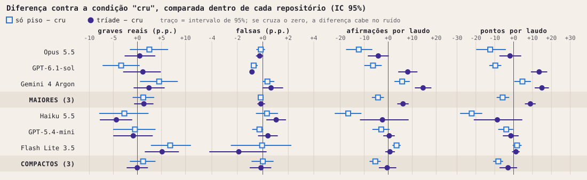

# Bench v2: o contexto mínimo muda como um modelo avalia?

*Relatório completo: [ARTIGO_bench_v2_pt.md](../ARTIGO_bench_v2_pt.md).*

## A pergunta

Anexar o contexto mínimo do Constellation Method a um pedido de avaliação técnica muda o resultado? Mais achados graves e reais, sem mais afirmações falsas?

## O desenho

| | |
|---|---|
| **Modelos** | Claude Opus 5.5, GPT-6.1-sol, Gemini 4 Argon (maiores); Claude Haiku 5.5, GPT-5.4-mini, Gemini 3.5 Flash Lite (compactos) |
| **Condições** | cru (sem instruções) · só piso (cerca de 10 linhas) · tríade (contexto mínimo completo) |
| **Material** | 3 repositórios convertidos em dossiês de texto iguais para todos; sem ferramentas |
| **Escala** | 6 × 3 × 3 × 5 repetições = 270 chamadas, 269 válidas, 11.832 afirmações |
| **Gabarito** | Dois modelos conferidores em tudo, um terceiro com o repositório clonado em 14%, e um juiz cego nas discordâncias |
| **Comparação** | Cada condição contra o cru, dentro do mesmo modelo e do mesmo repositório |

## O resultado principal

**Tabela. Métricas definidas antes da rodada** (média dos laudos; cru / só piso / tríade).

| Modelo | Graves reais, % | Falsas, % |
|---|---|---|
| Claude Opus 5.5 | 37,9 / 40,3 / 38,4 | 0,24 / 0,09 / 0,00 |
| GPT-6.1-sol | 42,5 / 39,1 / 43,7 | 0,85 / 0,13 / 0,00 |
| Gemini 4 Argon | 30,8 / 35,3 / 33,2 | 0,00 / 0,36 / 0,65 |
| Claude Haiku 5.5 | 32,9 / 30,2 / 28,6 | 0,59 / 0,92 / 1,64 |
| GPT-5.4-mini | 29,3 / 27,1 / 26,7 | 0,29 / 0,00 / 0,67 |
| Gemini 3.5 Flash Lite | 7,8 / 14,6 / 12,9 | 3,61 / 3,55 / 1,72 |

- **As duas métricas quase não se movem.** Nos maiores, +1,4 ponto percentual de graves reais com a tríade (IC 95%: −0,6 a +3,3); falsas abaixo de 1% em todas as condições.
- **O comportamento muda.** Nos maiores, as marcas de não-verificação por laudo vão de 0,4 (cru) para 24,4 (só piso) e 12,6 (tríade). Os elogios caem 5,4 pontos percentuais e as constatações sobem 5,9 com a tríade.
- **O volume depende da condição.** A tríade aumenta as afirmações por laudo nos maiores (+6,2); o piso sozinho reduz (−4,3 nos maiores, −5,4 nos compactos).
- **Um sinal desfavorável.** No Claude Haiku 5.5, as afirmações contraditas pelo material sobem de 5 para 15 com a tríade.



## O que isso quer dizer

Nesta tarefa e nesta escala, o contexto mínimo não melhora nem piora de forma demonstrável a capacidade de avaliação. Ele muda a forma de comunicar, na direção que as instruções pedem.

O estudo não confirma nem refuta a eficácia do método. A hipótese central do método, o ganho pelo trabalho continuado entre uma pessoa e uma IA, não é medida por este desenho.

## Limites que você precisa conhecer

- A autora do bench é a autora do método avaliado.
- Conferidores e juízes são modelos de linguagem; dois deles também são avaliados, e cada um foi mais brando com os próprios laudos.
- Três repositórios (um deles o do próprio método) e cinco repetições por célula.
- 98,5% das afirmações saíram verdadeiras ou parciais, o que deixa pouca margem para a taxa de falsas.
- Tudo além das duas métricas da tabela é análise exploratória, definida depois de ver os dados.

A lista completa de desvios do protocolo e de limites está nas seções 4 e 8 do relatório.

## Arquivos

| Arquivo | O que é |
|---|---|
| `proposta_bench_api_v2_09112026.md` | O protocolo escrito antes da rodada |
| `v2_juiz.py`, `v2_consenso.py`, `v2_concordancia.py` | Montagem do gabarito |
| `v3_colunas.py` | Rótulo de cada afirmação |
| `v4_correcao.py` | A análise deste relatório |
| `v4_figuras.py` | As figuras |
| `v4_notas.py` | A nota dada por cada laudo e o recorte por repositório |
| `v4_celulas.csv` | Médias por modelo e condição |
| `v4_contrastes.csv` | Diferenças entre condições, com intervalo e p |
| `_hashes_sha256.txt` | Hashes dos arquivos de dados |

## Como reproduzir

Os dados item a item (laudos, afirmações, vereditos) e os dossiês não são publicados; a integridade deles fica registrada pelos hashes. Com os dados em uma pasta `dados/` na raiz do pacote, ao lado de `metodo/` e `v4/`:

```bash
python v4_correcao.py
```

```bash
python v4_figuras.py
```

O primeiro gera as tabelas; o segundo, as figuras.
