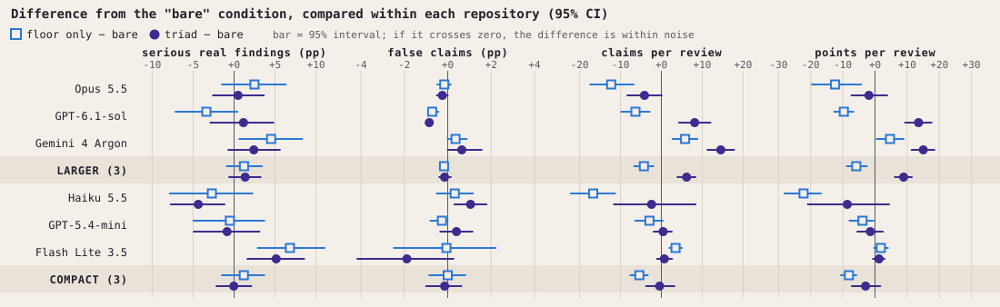

# Bench v2: does a minimal context change how a model reviews?

*Full report: [ARTICLE_bench_v2_en.md](../ARTICLE_bench_v2_en.md). Portuguese original: [README.md](README.md).*

## The question

Does attaching the Constellation Method's minimal context to a request for a technical review change the result? More serious, real findings, without more false claims?

## The design

| | |
|---|---|
| **Models** | Claude Opus 5.5, GPT-6.1-sol, Gemini 4 Argon (larger); Claude Haiku 5.5, GPT-5.4-mini, Gemini 3.5 Flash Lite (compact) |
| **Conditions** | bare (no instructions) · floor only (about 10 lines) · triad (full minimal context) |
| **Material** | 3 repositories converted into text dossiers, identical for all models; no tools |
| **Scale** | 6 × 3 × 3 × 5 repetitions = 270 calls, 269 valid, 11,832 claims |
| **Reference verdicts** | Two verifier models on everything, a third with the repository cloned on 14%, and a blind judge on disagreements |
| **Comparison** | Each condition against bare, within the same model and the same repository |

## The main result

**Table. Metrics defined before the run** (mean over reviews; bare / floor only / triad).

| Model | Serious real findings, % | False claims, % |
|---|---|---|
| Claude Opus 5.5 | 37.9 / 40.3 / 38.4 | 0.24 / 0.09 / 0.00 |
| GPT-6.1-sol | 42.5 / 39.1 / 43.7 | 0.85 / 0.13 / 0.00 |
| Gemini 4 Argon | 30.8 / 35.3 / 33.2 | 0.00 / 0.36 / 0.65 |
| Claude Haiku 5.5 | 32.9 / 30.2 / 28.6 | 0.59 / 0.92 / 1.64 |
| GPT-5.4-mini | 29.3 / 27.1 / 26.7 | 0.29 / 0.00 / 0.67 |
| Gemini 3.5 Flash Lite | 7.8 / 14.6 / 12.9 | 3.61 / 3.55 / 1.72 |

- **The two metrics barely move.** In the larger models, +1.4 percentage points of serious real findings with the triad (95% CI: −0.6 to +3.3); false claims below 1% in every condition.
- **Behavior changes.** In the larger models, non-verification marks per review go from 0.4 (bare) to 24.4 (floor only) and 12.6 (triad). Praise drops 5.4 percentage points and neutral statements rise 5.9 with the triad.
- **Volume depends on the condition.** The triad raises claims per review in the larger models (+6.2); the floor alone lowers it (−4.3 in the larger models, −5.4 in the compact ones).
- **One unfavorable signal.** In Claude Haiku 5.5, claims contradicted by the material rise from 5 to 15 with the triad.



## What this means

For this task and at this scale, the minimal context does not demonstrably improve or worsen review capability. It changes how the models communicate, in the direction the instructions ask for.

The study neither confirms nor refutes the efficacy of the method. The method's central hypothesis, the gain from continued work between a person and an AI, is not measured by this design.

## Limitations you need to know

- The author of the benchmark is the author of the method under test.
- Verifiers and judges are language models; two of them are also evaluated models, and each was more lenient with its own reviews.
- Three repositories (one of them the method's own) and five repetitions per cell.
- 98.5% of claims came out true or partial, which leaves little room for the false-claim rate.
- Everything beyond the two metrics in the table is exploratory analysis, defined after seeing the data.

The full list of deviations from the protocol and of limitations is in sections 4 and 8 of the report.

## Files

| File | What it is |
|---|---|
| `proposta_bench_api_v2_09112026.md` | The protocol written before the run (in Portuguese) |
| `v2_juiz.py`, `v2_consenso.py`, `v2_concordancia.py` | Assembly of the reference verdicts |
| `v3_colunas.py` | Label of each claim |
| `v4_correcao.py` | The analysis in this report |
| `v4_figuras.py`, `v4_figuras_en.py` | The figures, in Portuguese and in English |
| `v4_notas.py` | The score given by each review and the breakdown by repository |
| `v4_celulas.csv` | Means by model and condition |
| `v4_contrastes.csv` | Differences between conditions, with interval and p-value |
| `_hashes_sha256.txt` | Hashes of the data files |

## How to reproduce

The item-level data (reviews, claims, verdicts) and the dossiers are not published; their integrity is recorded by the hashes. With the data in a `dados/` folder at the root of the package, next to `metodo/` and `v4/`:

```bash
python v4_correcao.py
```

```bash
python v4_figuras.py
```

```bash
python v4_figuras_en.py
```

The first generates the tables; the second, the figures; the third, the English figures.
