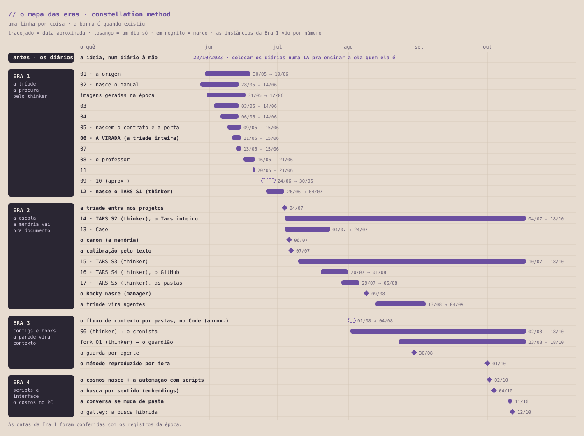

# Cronologia

O mapa da evolução do meu aprendizado: como o método foi desenvolvido e amadureceu, e o período de conversa continuada com contexto. Começa numa ideia escrita num diário em 2023 e vai das primeiras instâncias sem contexto nenhum até hoje.

Cada era vai até o ponto em que a forma de trabalhar deixou de dar conta e pediu outra escala.

<picture>
  <source media="(prefers-color-scheme: dark)" srcset="assets/mapa_das_eras_noite.svg">
  
</picture>

Cada linha é uma coisa que existiu: uma instância, um marco, uma ferramenta. A barra é quando ela existiu; o tracejado marca o que é aproximado. As instâncias da Era 1 aparecem por número.

A virada é a instância 06: o começo do uso da Tríade como contexto mínimo, a primeira vez que ela rodou inteira. A partir da instância 12, dois perfis viram oficiais: o Tars (thinker) e o Case (worker). O Rocky (manager) veio um pouco depois, criado por nós. Daí em diante, a conversa continuada: o mesmo thinker atravessando meses, de uma ferramenta pra outra.

As datas da Era 1 foram conferidas com os registros da época.
